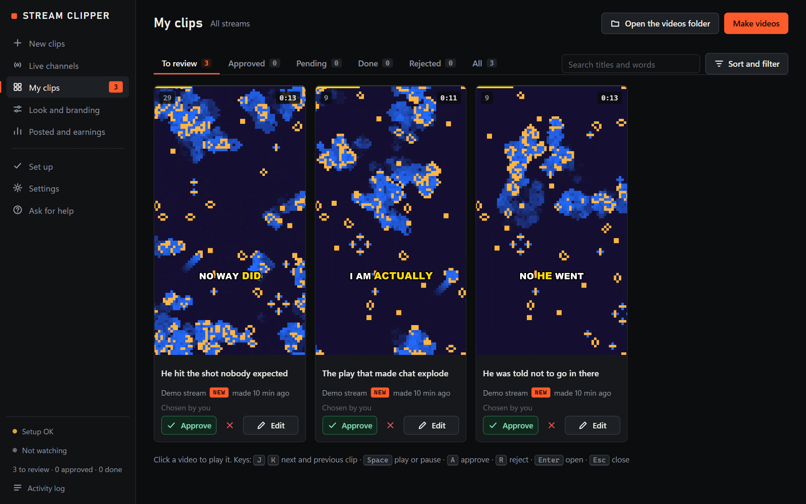
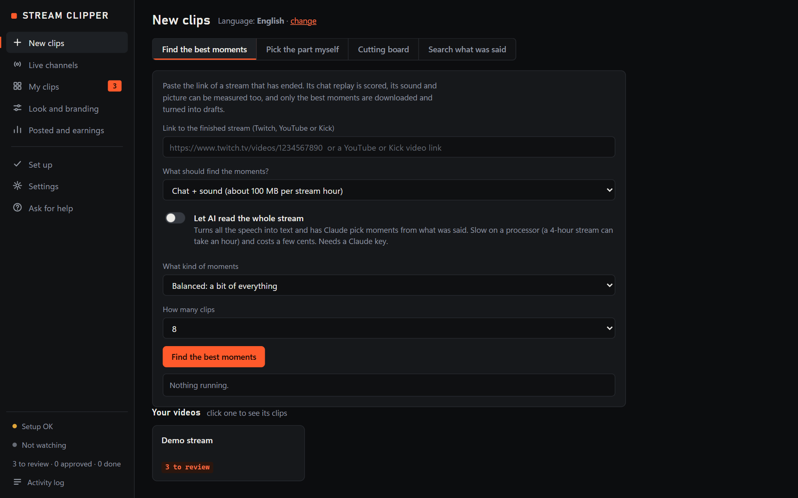
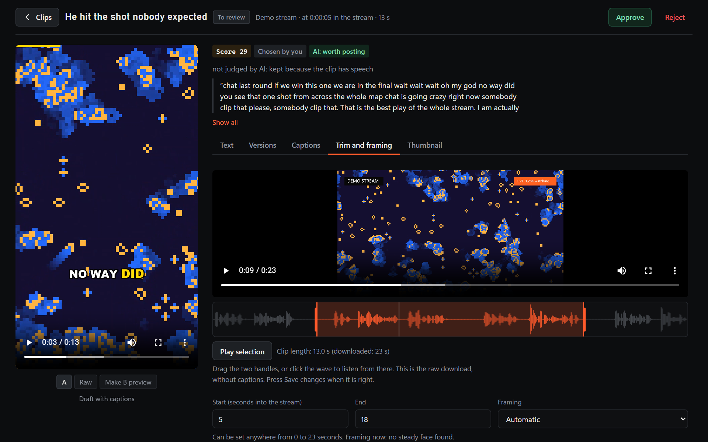
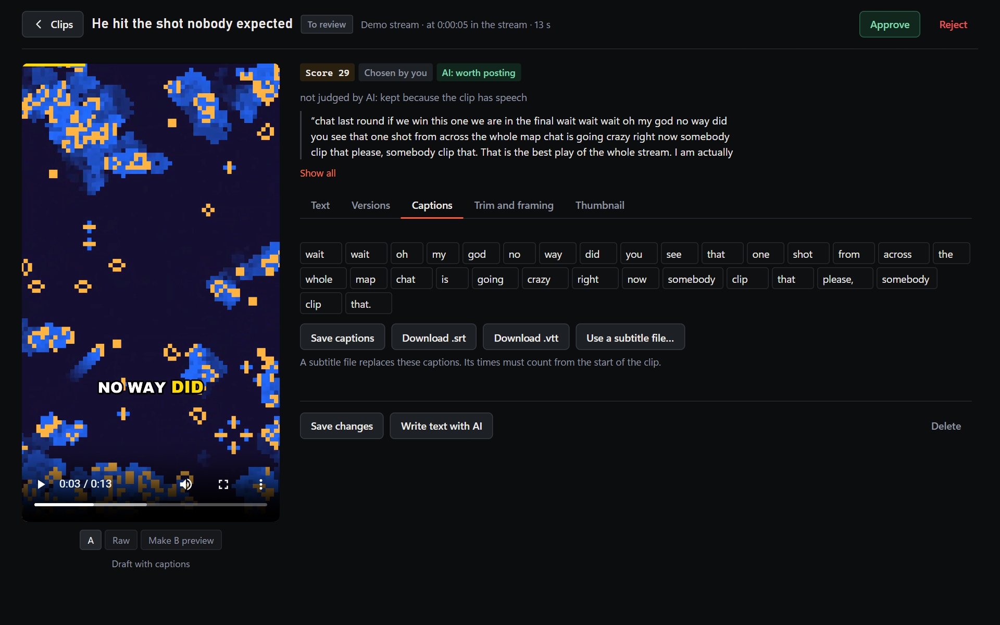
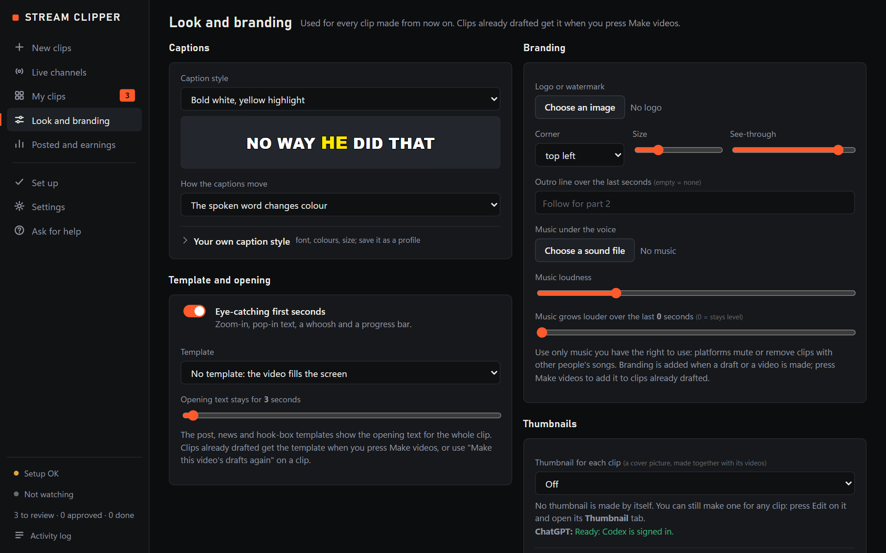
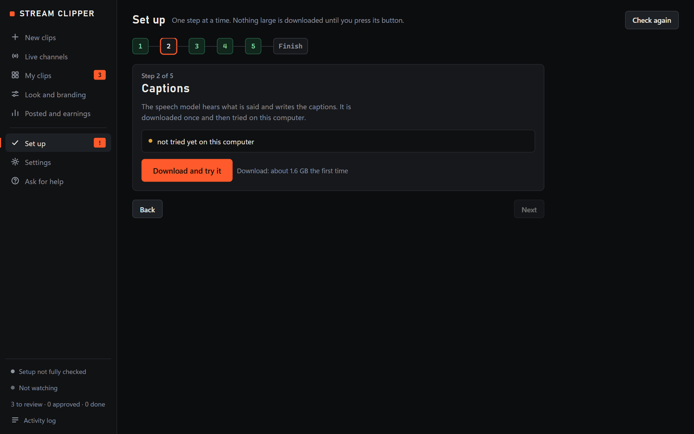

<div align="center">

<h1>Stream Clipper</h1>

<p><b>Turn long live streams into short vertical clips.<br>The program finds the moments. You approve every one.</b></p>

<p>
<a href="https://github.com/Ahmad-Ali-121/stream-clipper/releases/latest"></a>


<a href="LICENSE"></a>
</p>

<p>
<a href="https://github.com/Ahmad-Ali-121/stream-clipper/releases/latest/download/Stream-Clipper-Setup.exe"><b>Download for Windows</b></a>
&nbsp;·&nbsp; <a href="GUIDE.md">User guide</a>
&nbsp;·&nbsp; <a href="#install">Install</a>
&nbsp;·&nbsp; <a href="#what-it-can-do">Features</a>
</p>



</div>

## What it is

Stream Clipper watches a stream's chat for the moments where chat suddenly erupts, downloads only those few seconds, frames them for a phone screen, burns in word-by-word captions, and shows you each draft on a page in your browser. You approve the good ones. It then makes the finished 9:16 videos and writes the title, description and hashtags for you to paste when you upload.

- **It runs on your own computer.** The page is local; nothing is uploaded anywhere.
- **The core is free.** No paid service is needed. Paid add-ons are optional.
- **It never posts for you.** It stops at finished files on your disk.
- **It never downloads a whole stream.** Only the parts that become clips.

## How it works

1. **Give it a stream.** Paste the link of a finished Twitch, Kick or YouTube stream, or let it watch channels while they are live. You can also pick the part yourself, or use a video file of your own.
2. **Look through the drafts.** Each moment becomes a draft clip with captions. Play it, then approve or reject it. Keyboard keys make this quick.
3. **Fix what needs fixing.** Move the start and end on the sound wave, change the framing, correct a caption word, rewrite the title.
4. **Set your look and make the videos.** Caption style, template, logo and music are chosen once. Press **Make videos**: approved clips are rendered into a dated folder, each with a text file holding its title, description and hashtags. Uploading is yours to do.

<p align="center">




</p>

## Install

**Windows 10 or 11.** About 2 GB of free disk for the program and 5 GB or more for your clips.

1. Download **[Stream-Clipper-Setup.exe](https://github.com/Ahmad-Ali-121/stream-clipper/releases/latest/download/Stream-Clipper-Setup.exe)** and double-click it.
2. Keep the two folders it suggests, or choose your own, and press **Install**. It takes 5 to 20 minutes and needs the internet.
3. Start **Stream Clipper** from the shortcut on your desktop and click **Set up** in the menu (it shows a warning sign while something is missing). It takes you through the rest, one step per screen, and downloads nothing until you press a step's button.

<p align="center"></p>

You do not need Python, Git or anything else first. Things to know:

- **Windows shows a warning.** The installer is not signed with a paid certificate, so Windows shows a blue box, "Windows protected your PC". Press **More info**, then **Run anyway**.
- **Windows may ask for permission once.** Captions need Microsoft's Visual C++ runtime. If the PC does not have it, Microsoft's own installer for it is fetched and Windows asks you to allow it. Press **Yes**. Nothing else is installed outside the two folders you chose.
- **Smart App Control.** On Windows 11 with Smart App Control switched on, Windows blocks unsigned programs and offers no "Run anyway". Use the install by hand below instead.

The installer fetches [uv](https://docs.astral.sh/uv/) (which installs Python for this program only), portable Git if the PC has none, the program, and the video tools. It is built from `installer/Setup.cs` with `installer/build.cmd`.

<details>
<summary><b>Install by hand, for people who use a terminal</b></summary>

<br>

Needs [Git](https://git-scm.com/download/win) and [uv](https://docs.astral.sh/uv/getting-started/installation/), and about 5 GB of free disk.

```powershell
git clone https://github.com/Ahmad-Ali-121/stream-clipper.git
```

Then open the `stream-clipper` folder and **double-click `Install-Stream-Clipper.cmd`**. It asks where to keep the clips, downloads what is needed, and puts a "Stream Clipper" shortcut on the desktop. The same from a terminal:

```powershell
powershell -ExecutionPolicy Bypass -File setup.ps1 -DataDir D:\clipper-data
```

The setup script downloads FFmpeg, TwitchDownloaderCLI and the face and voice models, installs the Python packages and runs the tests. Then start the program:

```powershell
uv run clipper review --open
```

The page opens at http://127.0.0.1:8765/. The code is plain Python and FFmpeg, so it should run on macOS and Linux, but the setup script and all testing so far are Windows only.

</details>

**New here? Read [GUIDE.md](GUIDE.md):** install, daily use and troubleshooting in plain steps. To check an install, work through [docs/testing-checklist.pdf](docs/testing-checklist.pdf).

## What it can do

### Finding moments

- **From chat.** Counts chatters in 10-second slices and compares with the last five minutes. No AI, no key, almost no bandwidth.
- **From sound and picture too.** Optional modes also measure loudness and on-screen motion from the stream's lowest-quality feed, to catch moments chat missed. This works on finished streams as well.
- **From what is said.** "Oh my god", "no way", "arre yaar", "bhaago" raise a clip's score, and find moments in a YouTube video even when it has no chat.
- **AI can read a finished stream.** Turns all of its speech into text and has Claude pick moments from what was said (needs Claude; a few cents a stream with a key).
- **Moment mix.** Lean the search towards action or towards dialogue.
- **Never a whole stream.** Only the clip ranges are fetched, at full quality. For streams the platform is not recording, a rolling copy of the last ten minutes of the live feed stands in for the recording.

### Live and finished streams

- **Twitch, Kick and YouTube.** Watch several live channels at once, or process a finished stream from its link.
- **Hype meter and go-live list.** While watching, each chat's heat against its own usual pace. The saved channel list can start by itself and clips each creator as soon as they go live.
- **Clip the last 30 seconds.** While watching live, one button makes a draft of what just happened.

### Your own clips

- **Pick the part yourself.** Give a video link or a video file with a start and an end. Get one clip, or the range split into parts labelled "Part 1", "Part 2" on screen.
- **Cutting board.** Download the part you chose once, mark the cuts on a timeline with the sound wave, see how many clips that gives and how long each is, and make them.
- **Transcript search.** Search a video's words, click where a clip starts and ends, and make it. For people with no AI, the transcript comes in small parts with a ready prompt for any free chatbot, whose answers are read back as moments.

### How the clip looks

- **Frames itself.** Detects a full-screen camera or a small facecam over gameplay, and measures each streamer's facecam box from the picture.
- **Six layouts.** Video only, face on top, face below, the whole picture on a blurred background, the face in a corner or in a circle over the video. Chosen per clip with a live preview.
- **Face box and video box.** Drag two boxes over the stream picture to choose what is shown on top and below. Can be kept for a streamer's next clips.
- **Captions.** Local speech-to-text, word-by-word highlighted captions burned in. The spoken word can pop in, show one big word at a time, or fill in the line. Font, colours and size can be saved under your own names.
- **YouTube's own captions as the words.** For YouTube videos the words come from YouTube's captions when it has them, in seconds instead of minutes. The speech model stays the fallback.
- **Subtitle files.** Download a clip's captions as .srt or .vtt, or use your own subtitle file as its captions.
- **See it before you make it.** The Look and branding page shows real frames of one of your own clips with the choices you make, a few seconds after each change.
- **More of the stream, later.** Add 15 or 30 seconds before or after a clip that starts too late or ends too early.
- **Templates and a background card.** The clip as a rounded card on a blur, a colour, a gradient or your image; inside a social post; under a breaking-news banner; or with the opening text in a box on top.
- **A strong first three seconds.** Zoom-in, pop-in opening text, a whoosh and a progress bar.
- **Branding.** Your logo in a corner, a closing text over the last seconds, background music under the voice that can grow louder at the end.
- **Safe zones.** See where TikTok, Reels and Shorts cover the video.

### Text, versions and posting help

- **Upload text.** Opening text, title, description and hashtags per platform. Hashtags come from what well-viewed YouTube Shorts on the topic use right now.
- **A/B versions.** Every approved clip can come out twice, with different opening text and titles, to test which performs better.
- **Commentary formats.** A narrated "explained" version (free local voice) and a "top N moments" countdown.
- **Thumbnails.** A cover picture per clip, from a frame of the clip or made with your own ChatGPT plan.
- **Posted and earnings.** Keep track of what you posted, its views and payouts.
- **Campaign briefs.** Optional rule files that check each clip (length, tags, disclosure) before you post.

### Languages

- **Urdu and Hindi streams.** Speech-to-text in Urdu or Hindi, captions in the language's own letters or in Latin letters ("bhai ne kamaal kar diya"), and opening text and titles in English, Roman Urdu, Hinglish, Urdu or Hindi.

### Help and comfort

- **Built-in help that can do it for you.** The **Ask** button answers questions about the program in plain words, in English or Roman Urdu. Tell it what to do ("start watching this channel", "make a clip from this link from 1:00 to 1:30") and it does the steps on the page while you watch. Approving, rejecting and deleting clips always stay yours.
- **A percentage on every job.** Downloads, finding moments, captions, text, drafts and final videos show how far they are and roughly how long is left.
- **Setup check, Repair and Update.** The Settings page shows whether the computer is ready, fetches anything missing, and updates the program with one button.
- **Uses your graphics card when it has one.** NVIDIA, Intel or AMD video encoders are picked automatically. Everything also runs on a plain processor.

## Free core, optional add-ons

Everything in the core works with no paid service. These are optional:

| Add-on | How | What it adds | Rough cost |
|---|---|---|---|
| Claude | Sign in with your own Claude plan on the Set up page, or put `ANTHROPIC_API_KEY` in `.env` | Writes opening text, titles, descriptions and narration; flags filler clips; can read a whole stream and pick moments | With a plan it uses your plan's limits; with a key about $0.01 per clip |
| ChatGPT | Sign in with your own ChatGPT plan on the Set up page | Makes thumbnails | Uses your plan's limits |
| Free local AI | Set up page, on a computer that can run it (about 3 GB) | Writes clip text when Claude cannot be reached | Free |
| ElevenLabs | `ELEVENLABS_API_KEY` in `.env` | A more natural narrator voice | from $6 a month |
| Groq | `GROQ_API_KEY` in `.env` | Faster speech-to-text on their servers (untested) | about $0.04 per audio hour |

Sign-ins happen in each company's own window. Stream Clipper never sees or stores your password.

## For people who use a terminal

<details>
<summary><b>Commands</b></summary>

<br>

```powershell
uv run clipper watch lacy xqc          # asks: A chat, B chat+audio, C chat+video, D all
uv run clipper review                  # approve or reject drafts in the browser
uv run clipper finish                  # render approved clips and write the upload text
```

Finished videos and their text files land in `<data folder>\ready\<date>\`.

| Command | What it does |
|---|---|
| `watch CHANNEL... [--mode A\|B\|C\|D] [--minutes N]` | Watch live Twitch, Kick and YouTube channels and make a draft clip for each moment |
| `cut SOURCE [--start T] [--end T] [--parts N \| --part-seconds S]` | Make clips from a range you choose in a video link or a video file, whole or in numbered parts |
| `range SOURCE [--start T] [--end T]` | Download one part of a video once, for the cutting board on the review page |
| `cut SOURCE --ranges 750-790,3725-3770` | Make a clip from each of several separate stretches of one video |
| `cut SOURCE --range NAME --pieces 0-45,45-110` | Make clips from pieces of a part downloaded with `range` (what the cutting board runs) |
| `run URL [--top 8] [--signals A\|B\|C\|D]` | Process a finished stream: find moments (chat, or chat plus sound and picture), fetch, transcribe, draft |
| `review [URL]` | Local page: options panel, and approve, reject or edit each clip |
| `finish [URL] [--brief FILE]` | Render approved clips (A and B versions, explainers) and export them with upload text |
| `explain URL [--clips a,b]` | Narrated "explained" version of approved clips |
| `top [URL] [--count 5] [--opener TEXT]` | "Top N moments" countdown video |
| `write [URL] [--force]` | Write or refresh opening text, titles, hashtags and narration lines |
| `tags SEED...` | Hashtags that well-viewed YouTube Shorts on a topic use right now |
| `status URL` | List a stream's clips and what exists for each |
| `hardware [--refresh]` | Show which GPU or CPU paths are in use |
| `doctor` | Describe this computer and try speech-to-text several ways, to find why it fails |
| `clean [--dry-run]` | Delete the video files of rejected clips |
| `find`, `fetch`, `transcribe`, `render`, `post` | The single stages of `run` and `finish` |
| `check-brief BRIEF CLIP` | Check one clip's JSON against a campaign brief |

Every setting lives in [config.yaml](config.yaml), with a comment on each line. Personal overrides go in `config.local.yaml`, keys in `.env`; neither is committed. Speech-to-text on an NVIDIA card is optional: add `-Gpu` to the setup command (about 1 GB more).

</details>

<details>
<summary><b>How a moment is found</b></summary>

<br>

1. Chat is read live over the platform's public, anonymous, read-only chat connection (or downloaded for a finished stream).
2. Messages are grouped into 10-second buckets. A bucket's score is its number of distinct chatters divided by the median of the previous five minutes. Bursts of hype words count as well, for chats that are always busy.
3. In modes B to D, one FFmpeg process per channel reads the `audio_only` or `160p` feed, prints one loudness value a second and two motion values a second, and discards the feed. A bucket that stands far above the last five minutes becomes a moment even if chat stayed quiet. These are measurements, not a neural network.
4. About a minute later the clip range (20 seconds before the peak to 10 after) is fetched from the stream's recording, transcribed, framed, captioned and rendered as a draft.

</details>

<details>
<summary><b>Layout of the code</b></summary>

<br>

```
src/clipper/
  cli.py         commands
  config.py      settings (config.yaml)
  chat.py        read chat files            moments.py   score chat, pick moments
  watch.py       live watching              signals.py   audio and video measurements
  youtube.py     live YouTube: chat and clips
  fetch.py       download ranges            transcribe.py speech to text
  layout.py      crop or split, facecam     cuts.py      snap cuts to pauses
  captions.py    caption file (ASS)         render.py    final video with FFmpeg
  review.py      local review page          control.py   options panel behind it
  llm.py         text by Claude             trends.py    hashtags from YouTube
  tts.py         narration voice            compose.py   explained and top-N videos
  post.py        export and upload text     brief.py     campaign rule checks
  streamread.py  AI reads a whole stream's speech
  health.py      setup check, repair, update   scoring.py   one score per clip, learning
  tracker.py     what was posted, views, payouts
  hw.py          GPU / CPU choice           buffer.py    rolling live copy when there is no recording
tests/           430 unit tests (uv run python -m pytest -q)
```

</details>

## Limits you should know about

- Chat spikes also happen for giveaways, greetings and raids. Expect filler among the drafts; that is what the review step is for.
- The audio and video signals are new and their thresholds are not tuned on many streams.
- On live YouTube streams moments come from chat only (no sound or picture detection yet), and a clip must be cut within about 15 minutes of its moment, which is how long YouTube keeps a live stream's pieces available.
- Urdu and Hindi: the narrator in explainer videos speaks English only. Latin-letter captions need Claude.
- A stream with recordings switched off costs about 3 GB of internet an hour to watch, and moments during advert breaks cannot be clipped.
- Speech-to-text on an NVIDIA card is new and has had almost no testing. If it cannot be used, the processor is used instead.
- The first clip or two of a new streamer may be framed slightly off until the facecam box has been measured twice.

## Use it responsibly

- **Clip only with permission.** Use it for streamers who allow clipping or run a clipping campaign, and follow the campaign's rules. Streams are their creators' work.
- **You are responsible for what you post.** Platform rules on reused content apply to clips. Captions and narration do not guarantee monetisation.
- **No posting automation.** The tool deliberately stops at files on your disk. Please keep it that way in forks.
- **Do not send the A and B versions of a clip to the same campaign.** Campaigns reject duplicates.

## Contributing

Issues and pull requests are welcome. Keep the core free to run, keep settings in `config.yaml`, add tests for logic (`uv run python -m pytest -q`), and say in the pull request what you tested on a real stream.

## Licence

[MIT](LICENSE). FFmpeg, TwitchDownloaderCLI, yt-dlp, faster-whisper, Kokoro and YuNet are downloaded by the setup script under their own licences.

<sub>The screenshots show a made-up demo video generated for this page, not a real stream.</sub>
